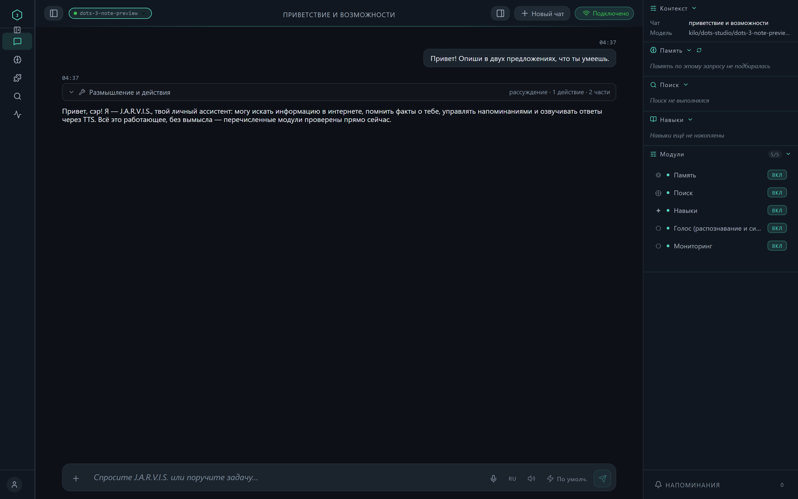
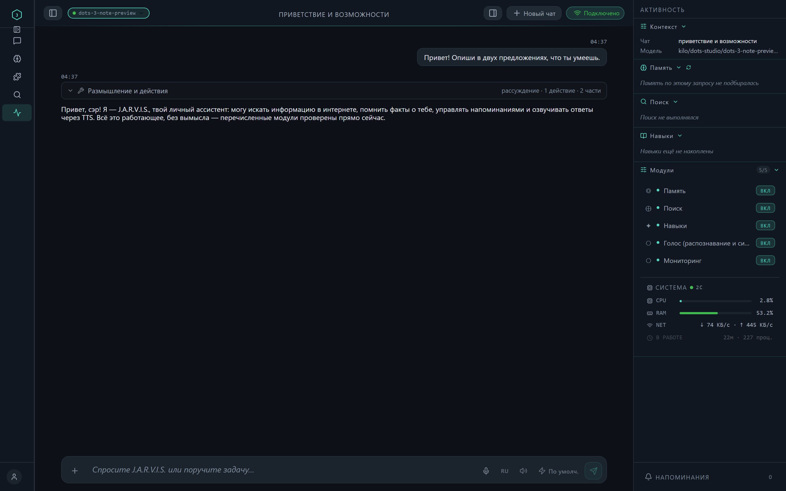
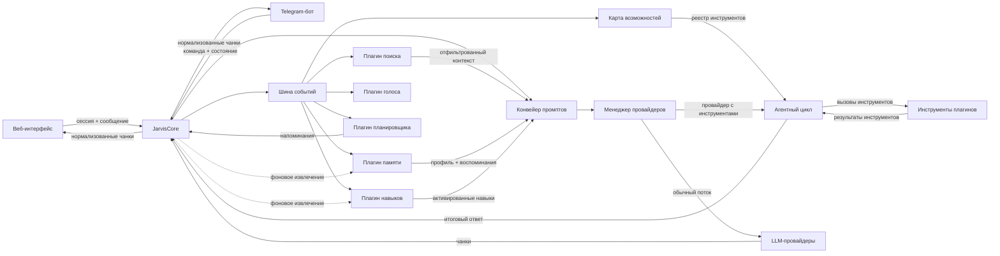

# J.A.R.V.I.S. — техническое описание

**J.A.R.V.I.S.** (Just A Rather Very Intelligent System) — персональная AI-платформа и ассистент с несколькими интерфейсами, долговременной памятью, расширяемой плагинной системой и отказоустойчивым выбором модели.

Это публичное описание проекта. В репозитории намеренно нет исходного кода, ключей, локальных путей, данных пользователей и рабочих конфигураций. Исходная система остаётся приватной; здесь показаны только принципы проектирования, потоки данных и демонстрационные материалы.

*Актуально на 26.10.2026: ядро v3.9.0 · 7 плагинов · 2000+ автотестов.*



<sub>Главный экран веб-интерфейса: диалог с потоковым ответом и свёрнутыми «Размышлениями и действиями», справа — панель контекста (память, поиск, навыки, состояние модулей) и панель напоминаний. Скриншот демонстрационной сессии.</sub>



<sub>Вкладка «Активность»: состояние модулей и монитор системы рядом с диалогом.</sub>

## Почему этот проект важен

J.A.R.V.I.S. — мой основной личный проект для практического применения LLM в реальной ежедневной работе. Проект объединяет оркестрацию ИИ, автоматизацию, долговременную память, инструменты и несколько интерфейсов в единую систему. Архитектура развивается вокруг принципа «сказал → сделал», а не вокруг демонстрации отдельных моделей.

## Стек технологий

| Область | Используется |
|---|---|
| Ядро | Python, FastAPI, Uvicorn, SQLite/FTS5, векторный поиск на эмбеддингах |
| LLM | API, совместимые с OpenAI; Kilo Gateway (бесплатные модели, основной с 16.10.2026), Groq, OpenRouter; опционально Gemini, DeepSeek, Kimi, Claude, локальный GGUF/Ollama |
| Интерфейсы | React, WebSocket, Telegram / aiogram, трей Windows |
| Архитектура | Абстракция провайдера, система плагинов, шина событий, долговременная память, агентный цикл |
| Тестирование | pytest, pytest-asyncio (2000+ юнит-тестов), smoke-тесты, регрессионные тесты WebSocket, E2E-тесты Playwright, самопроверка ходов (инварианты + LLM-судья) и «доктор» плагинов |
| Инфраструктура | Windows (основная), кроссплатформенные пути выполнения |

## Что умеет J.A.R.V.I.S.

- **Несколько интерфейсов**: веб-приложение с потоковой передачей ответа и Telegram-бот.
- **Поставщики LLM**: единый контракт для разных поставщиков и моделей.
- **Отказоустойчивость провайдеров**: cooldown, контрольный таймаут первого чанка и авто-откат агентного пути — отказ до первого чанка уводит ход на живой резерв с инструментами и показывает честную плашку; после начала ответа модели не смешиваются.
- **Потоковая передача**: построчная передача ответа и понятное состояние соединения.
- **Долгосрочная память**: локальное SQLite-хранилище, извлечение фактов, профиль пользователя, векторный поиск по воспоминаниям и истории чатов, семантическая склейка дублей и автоочистка устаревших записей.
- **Навыки**: процедурная память — удачные приёмы сохраняются и продвигаются по счётчику применений; подбор навыка под запрос — по смысловому сходству (векторный recall); доверие навыку подтверждается вручную.
- **Напоминания**: планировщик на естественном языке («через 10 минут», «завтра в 9:00») с дедупликацией, snooze и сводкой пропущенных; повторяющиеся формулировки («каждый день в 9», «по будням в 9:00») переживают свой выстрел и ставятся на следующий срок.
- **Проактивность**: условное слежение («следи за X — сообщи, когда Y») — триггер проверяет результаты фоновых инструментов по локальному предикату, без запроса к модели; антиспам-бюджеты, cooldown и тихие часы; длинные задачи показываются в интерфейсе живым трекером с текущим шагом.
- **Голос**: синтез речи и локальное распознавание с цепочкой движков и управляемым фолбэком.
- **Система плагинов**: подключаемые модули, события, инструменты и жизненный цикл через манифесты.
- **Карта возможностей**: честный реестр «что умею» — инструменты и команды плагинов объявлены и запрещены по умолчанию, пока не разрешены явно.
- **Маршрутизация намерений**: определение потребности в актуальном веб-поиске до сборки основного запроса.
- **Поиск в вебе**: получение контекста, его фильтрация и передача модели вместе с источниками.
- **Слой безопасности**: разделение внешних данных и инструкций, фильтрация инъекций, карта возможностей плагинов (fail-closed), подтверждение опасных действий карточкой в интерфейсе, песочница команд и аудит.
- **Проверка результата**: после команд агент сверяет реальный эффект (файл, порт, процесс), а не только код возврата.
- **Операционная наблюдаемость**: состояние провайдеров, квоты, состояние модулей и журналы работы.

## Архитектура

Это логическая схема текущей реализации, а не точная копия структуры исходного кода. Основные потоки следующие:



Полная схема: [assets/architecture.svg](assets/architecture.svg).

## Документация

- [Архитектура](docs/architecture.md) — логические слои, компоненты и основные потоки данных.
- [Провайдеры](docs/providers.md) — единый контракт, выбор модели, резервный провайдер, потоковая передача и состояние провайдеров.
- [Память](docs/memory.md) — извлечение, хранение, поиск и безопасность долгосрочной памяти.
- [Система плагинов](docs/plugin-system.md) — жизненный цикл модулей, события, инструменты и расширение возможностей.

Основной принцип — интерфейс не знает, какой поставщик реально выполнил запрос. Ядро собирает контекст и координирует модули, Менеджер провайдеров отвечает за доступность поставщиков, а плагины добавляют данные и инструменты через события и контракты.

## Разработка с участием ИИ

Проект активно разрабатывается с использованием ИИ-инструментов. Claude Code и другие LLM используются для исследования решений, декомпозиции задач, генерации и анализа кода, написания тестов и рефакторинга. Архитектурные решения, интеграция, проверка результатов и финальная валидация остаются ответственностью разработчика.

## Почему архитектура такая

**Разделение ответственности.** Веб- и Telegram-интерфейсы занимаются только транспортом: авторизацией, вводом, отображением и событиями соединения. JarvisCore остаётся единой точкой координации диалога, истории и политик безопасности. Благодаря этому одно и то же ядро можно использовать через разные интерфейсы без дублирования бизнес-логики.

**Провайдер как заменяемый адаптер.** Модель выбирается на уровне конфигурации, но ядро работает с абстрактным контрактом. Если основной поставщик недоступен, Менеджер провайдеров пробует следующий кандидат, отслеживает cooldown и передаёт пользователю понятное уведомление. Запросы плагинов используют отдельный чистый путь, чтобы вспомогательные операции не меняли активную сессию.

**Плагины расширяют, а не переписывают ядро.** Память, поиск, навыки и голос работают как модули с собственным жизненным циклом. Они подписываются на события, инжектируют ограниченный контекст в PromptPipeline или предоставляют инструменты. Такая модель позволяет добавлять возможности без увеличения монолита и без изменения контрактов интерфейсов.

## Что было сложно

- **Потоковая передача + резервный провайдер**: нужно было не переключать поставщика после начала ответа, чтобы не смешивать части одного сообщения.
- **Авто-откат на агентном пути**: переключение живёт только до первого чанка; резерв обязан уметь инструменты, иначе ход «подешевеет» молча; пользователю показывается честная плашка о работе через резерв.
- **Ротация бесплатных каталогов моделей**: идентификаторы умирают молча (401/404/429) — систему приходится отличать «мёртвый путь» от временного лимита: лимит лечится ожиданием, а не сменой модели.
- **Склейка дублей памяти**: похоже сформулированные записи — не обязательно дубли (одинаковая структура при разных предметах), поэтому объединение требует двух условий одновременно: семантической близости эмбеддингов и пересечения формулировок.
- **Условное слежение без LLM**: проверка триггера («меньше», «больше», «содержит», «изменилось») выполняется локально над результатом инструмента — генерация в цикле проверок означала бы непредсказуемую цену и ложные срабатывания; модель вызывается только когда триггер уже сработал.
- **Абстракция провайдера**: разные API имеют разные форматы ошибок, потоковой передачи и квот, но должны выглядеть для ядра единообразно.
- **Безопасность памяти**: внешние и диалоговые данные нельзя передавать модели как доверенные инструкции; нужны фильтрация, приоритеты и аудит.
- **Маршрутизация намерений**: поиск должен запускаться по смыслу запроса, а не по списку запрещённых или обязательных слов.
- **Конкурентность**: фоновые задачи памяти и поиска не должны блокировать основной цикл событий или портить текущий ответ.
- **Операционная надёжность**: опрос состояния, cooldown и понятные ошибки важны не меньше, чем сама генерация.

## Демонстрационные материалы

| Материал | Что показывает |
|---|---|
| [web-chat.png](assets/web-chat.png) | Скриншот веб-интерфейса: диалог с ассистентом и панель контекста |
| [web-activity.png](assets/web-activity.png) | Скриншот веб-интерфейса: вкладка «Активность» — модули и монитор системы |
| [architecture.svg](assets/architecture.svg) | Слоистая архитектура и поток запроса |
| [web.svg](assets/web.svg) | Схематичный интерфейс веб-приложения |
| [telegram.svg](assets/telegram.svg) | Сценарий общения через Telegram |
| [memory.svg](assets/memory.svg) | Извлечение, хранение и использование памяти |

Схемы являются архитектурными мокапами. Скриншоты сняты на специально созданной демонстрационной сессии: в них нет реальных чатов, ключей и пользовательских данных.

## Конфиденциальность

Исходный код является приватным, поскольку проект представляет собой личную систему. Архитектура, проектные решения и скриншоты опубликованы публично. Исходный код может быть предоставлен для технического обзора по запросу.

В публичном описании проекта намеренно не опубликованы:

- `.env` и значения API-ключей;
- токены, учетные записи и разрешённый список пользователей;
- локальные пути, имена хостов и данные процессов;
- история чатов, SQLite-базы и пользовательские факты;
- исходные файлы приватного репозитория.

## Структура публикации

```text
JARVIS-Case-Study/
├── README.md
├── docs/
│   ├── architecture.md
│   ├── providers.md
│   ├── memory.md
│   └── plugin-system.md
├── assets/
│   ├── web-chat.png
│   ├── web-activity.png
│   ├── architecture.svg
│   ├── web.svg
│   ├── telegram.svg
│   └── memory.svg
└── examples/
    ├── config.example.env
    └── plugin.example.md
```
